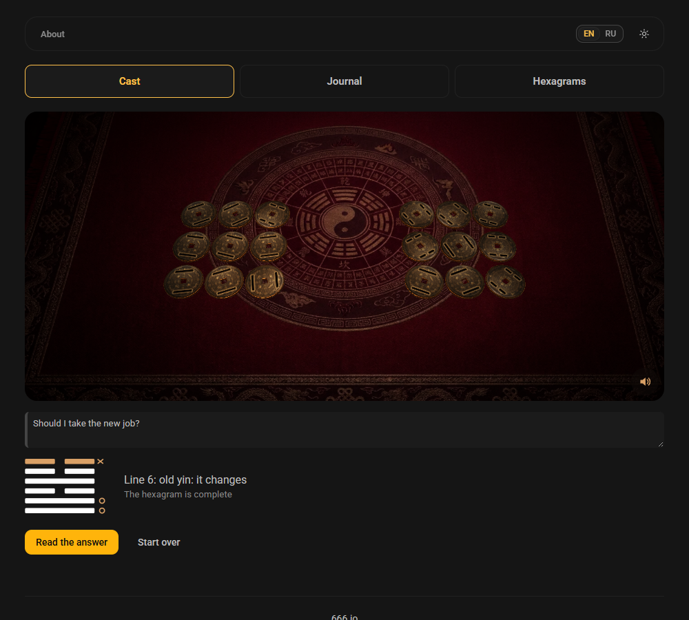
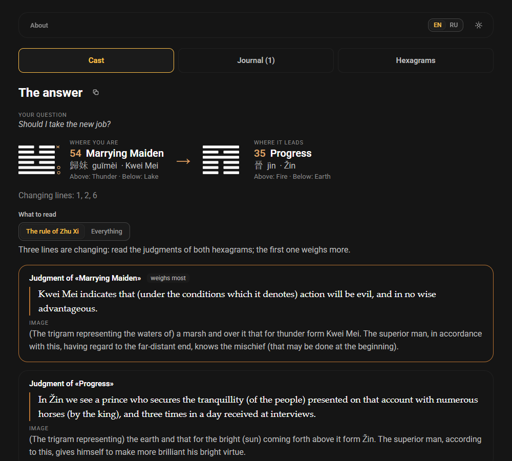
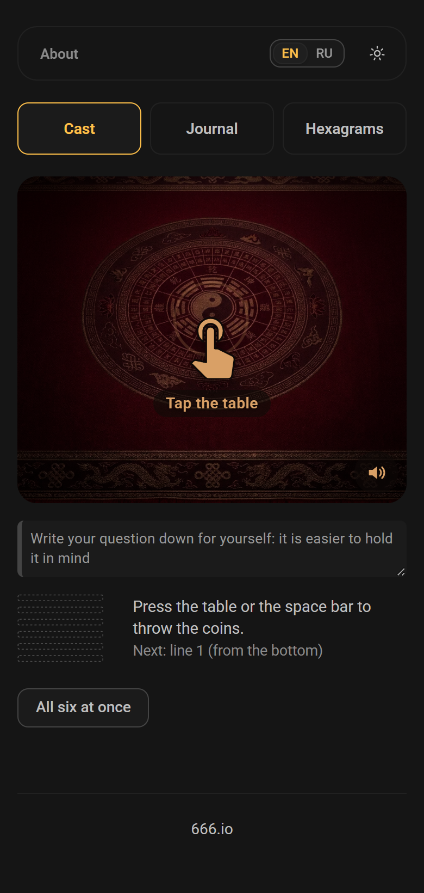
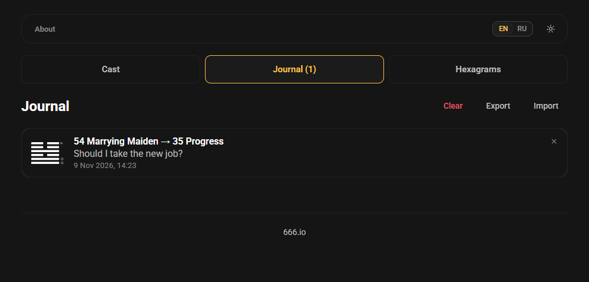

<h1 align="center">Hexa Proof</h1>

<p align="center">
  
  
</p>
<p align="center">
  
  
</p>

**English** · [Русский](README.ru.md)

An oracle of the Book of Changes (I Ching). You throw three coins six times on a dark lacquer table, the app builds the hexagram line by line and shows the classic text for it. Nothing is interpreted by a machine: the words are those of the book, the app only does the counting and picks the places to read.

Vue 3 + TypeScript + Vite + [TaoUI](https://www.npmjs.com/package/@1337exp/taoui) and [TaoUX](https://www.npmjs.com/package/@1337exp/taoux), the table is Three.js. The interface and the book are in English and Russian.

## Commands

```bash
npm install
npm run dev          # development; the toss lab is at /lab/coin.html
npm run build        # vite build
npm test             # vitest
npm run typecheck    # the core without DOM, then the app with vue-tsc
npm run texts        # rebuilds the two text packs from sources/ (see «The texts»)
npm run screenshot   # the pictures for this README, docs/media/*.png (needs Chrome or Edge)
```

## What it does

- **The cast.** The method of three coins: the side with the animals is yang (3), the side with the trigrams is yin (2), a throw adds three coins into 6, 7, 8 or 9, with the chances 1/8, 3/8, 3/8, 1/8. Six throws give the hexagram from the bottom line up. Sixes and nines are changing lines and give a second hexagram. The numbers come from the system source (`crypto.getRandomValues`), not from `Math.random`. The question is a note for yourself and does not affect the cast.
- **The table.** Press the table (or the space bar) to throw; «All six at once» throws the rest. Bronze coins are lifted, spin, and are pressed into the felt with a bump, then slide into the columns on the sides, three coins per throw, trigram by trigram. Each landing is a beat of a dull deep drum (made by WebAudio on the spot, no files; a switch in the corner of the table). After the sixth throw a wave of glow runs over them. `prefers-reduced-motion` turns the show off: the result appears at once. Without WebGL the flat coins are shown instead.
- **The reading.** Reading the answer saves it to the journal at once (a button at the bottom removes it), and an icon next to «The answer» copies it as plain text, to send to a friend or to an assistant. Two ways to choose the places of the book: the rule of Zhu Xi (short: what weighs most) and «Everything». The screen says why these places were chosen.
- **The texts.** Russian: Yu. K. Shchutsky; English: James Legge (1882). The language of the book follows the language of the interface. The verdict, the image, the six lines, and the closing words of hexagrams 1 and 2.
- **The library.** All 64 hexagrams, searchable by number and name, with their trigrams.
- **The journal.** A reading is saved with the question, the date and a note of your own. A row is deleted with the cross in its corner or by a long swipe (both ask first); the whole journal can be cleared. It is kept on the device (the six numbers 6–9, not the random seed), exported to a JSON file and imported back; what is already there is never overwritten.
- Light and dark themes, a narrow screen (a phone), the keyboard.

## How it is made

- `src/core` has no DOM: the hexagrams and trigrams, the cast, the rules of reading, the journal file. `src/app` is the interface. Two `tsconfig`s keep the border.
- **The toss is a storyboard, not physics.** The result is drawn first, then the animation is led to it (a closed-form damped spring, the same idea as the dice in pkt-dice), so a coin can never land «wrong» and nothing jitters. The property «the top face equals the ordered one» is tested on random plans.
- The scene uses [`@1337exp/pkt-threejs-blueprint`](https://www.npmjs.com/package/@1337exp/pkt-threejs-blueprint): the renderer, resize, the loop. The background is a picture of the table; an invisible plane receives the shadows of the coins; glow is a bloom pass that is on only during the wave.
- **The texts** are packs (`src/data/texts/ru.json`, `en.json`) built by parsers from the sources. The sources have defects (wrong drawings, a missing line, swapped hexagrams); every one is pinned by a test and listed in [docs/texts.md](docs/texts.md).
- Tests: `npm test` (hexagrams, cast and its chances, reading rules, the toss plan, the coin geometry, the journal, both parsers). The check of the table of facts against an outside list runs only when that list is on the machine.

## The texts

`sources/` is git-ignored (the files are not ours to hand out). The ready packs are in the repository, so `npm run dev` works without them; `npm run texts` needs `sources/`. Where each text comes from and under what terms: [THIRD-PARTY-NOTICES.md](THIRD-PARTY-NOTICES.md).

The Russian text of Shchutsky is protected until 31 December 2026 (he was shot in 1938 and rehabilitated in 1956; art. 1281 of the Civil Code of the Russian Federation), so the Russian pack goes into a public repository only from 1 January 2027. This is our reading of the law, not legal advice.

## Not yet

- A bronze chime for the wave of glow, incense smoke over the table.
- The method of yarrow stalks (other chances).
- The Thwan commentary and the small symbolism of the lines of Legge, the introduction and the footnotes.

## License

MIT, see [LICENSE](LICENSE). The books are not covered by it: Legge (1882) is in the public domain, Shchutsky see above; Roboto is under SIL OFL 1.1. Details: [THIRD-PARTY-NOTICES.md](THIRD-PARTY-NOTICES.md).

## Us

Homepage: [666.io](https://666.io). If you want to help, suggest an idea or just talk, come by.
