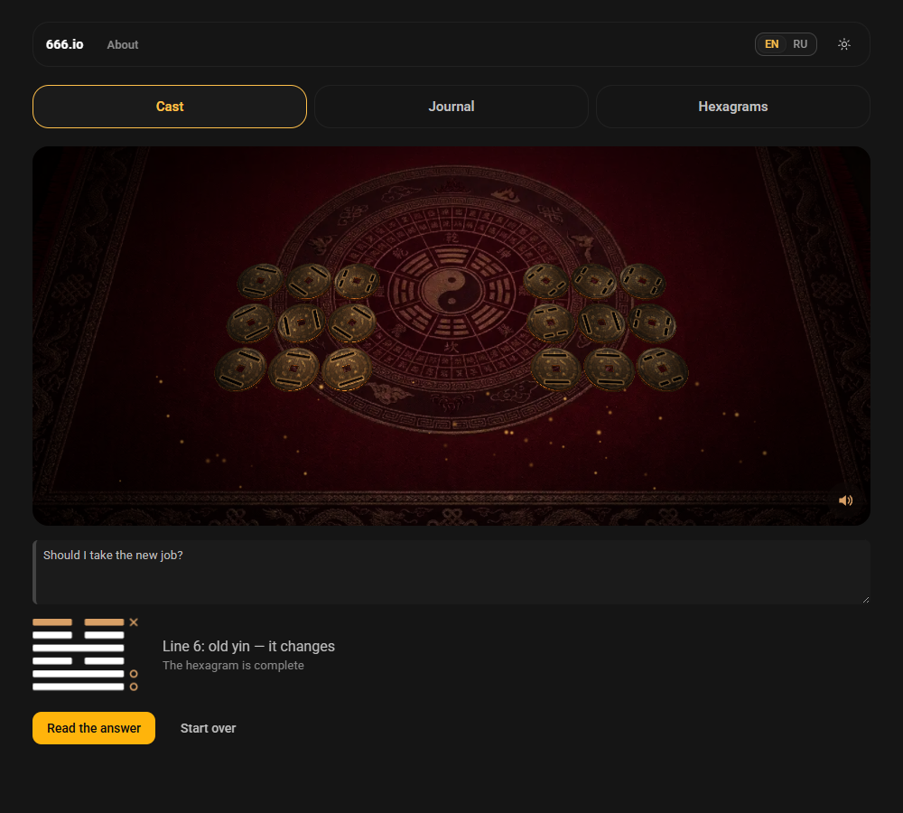
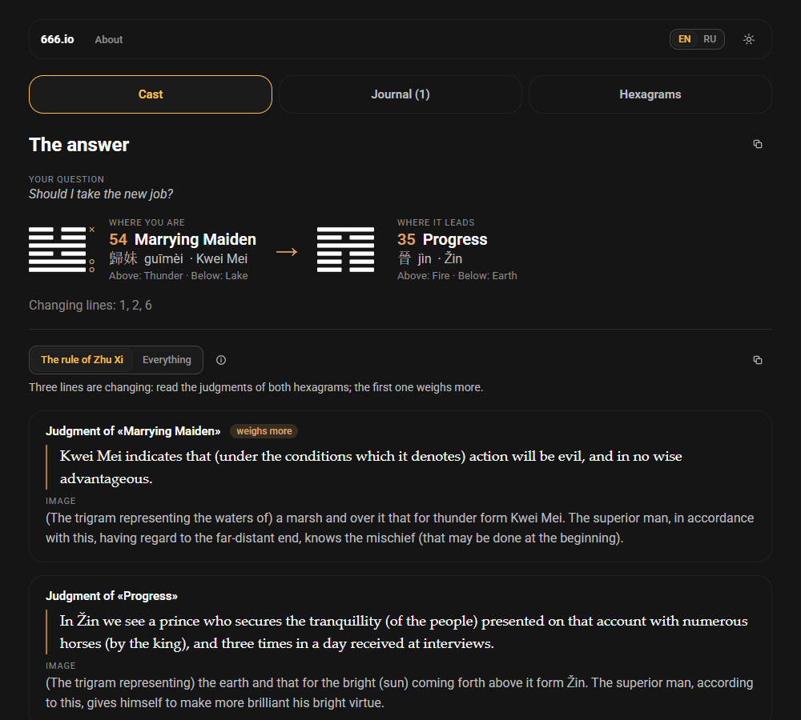
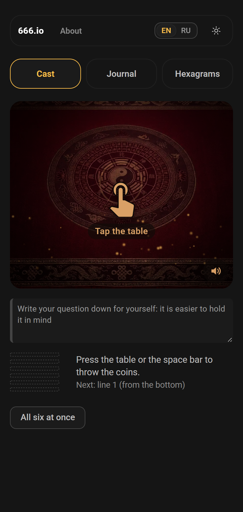
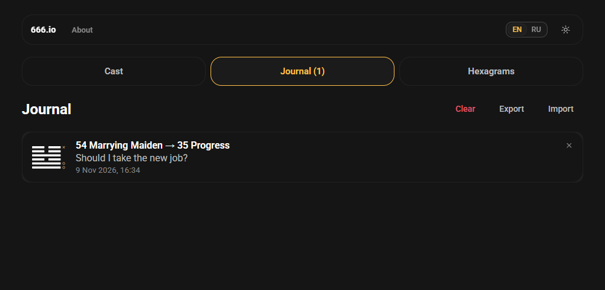

<h1 align="center">Hexa Proof</h1>

<p align="center">
  
  
</p>
<p align="center">
  
  
</p>

[English](README.md) · **Русский**

Оракул по Книге перемен (И-цзин). Вы шесть раз бросаете три монеты на тёмном лаковом столе, приложение выстраивает гексаграмму по линии и показывает к ней классический текст. Машина ничего не толкует: слова это слова книги, приложение только считает и выбирает, какие места читать.

Vue 3 + TypeScript + Vite + [TaoUI](https://www.npmjs.com/package/@1337exp/taoui) и [TaoUX](https://www.npmjs.com/package/@1337exp/taoux), стол на Three.js. Интерфейс и книга на русском и английском.

## Команды

```bash
npm install
npm run dev          # разработка; стенд броска: /lab/coin.html
npm run build        # vite build
npm test             # vitest
npm run typecheck    # ядро без DOM, затем приложение через vue-tsc
npm run texts        # пересобрать два пакета текстов из sources/ (см. «Тексты»)
npm run screenshot   # картинки для этого README, docs/media/*.png (нужен Chrome или Edge)
```

## Что умеет

- **Гадание.** Метод трёх монет: сторона с животными это ян (3), сторона с триграммами это инь (2), бросок складывает три монеты в 6, 7, 8 или 9 с шансами 1/8, 3/8, 3/8, 1/8. Шесть бросков дают гексаграмму от нижней линии вверх. Шестёрки и девятки это движущиеся линии, они дают вторую гексаграмму. Числа берутся из системного источника (`crypto.getRandomValues`), не из `Math.random`. Вопрос это заметка для себя, на бросок он не влияет.
- **Стол.** Нажмите на стол (или пробел), чтобы бросить; «Сразу все шесть» бросает остальные. Бронзовые монеты поднимаются, вертятся и с «бам» впечатываются в сукно, потом отъезжают в колонки по бокам, по три на бросок, триграмма за триграммой. От ближнего края стола поднимаются мягкие искорки (один вызов отрисовки, на процессоре за кадр почти ничего; при `prefers-reduced-motion` выключены). При каждом броске звучит щелчок монет, а когда после шестого броска по ним пробегает волна свечения, звучит удар барабана тайко (выключатель в углу стола). При `prefers-reduced-motion` зрелище выключено: результат появляется сразу. Без WebGL показываются плоские монеты.
- **Чтение.** Когда вы читаете ответ, он сразу сохраняется в журнал (кнопка внизу удаляет его), а значок рядом с «Ответ» копирует, что выпало (вопрос, гексаграммы, движущиеся линии), а значок у «Что читать» копирует текст книги, оба простым текстом, чтобы отправить другу или ассистенту. Два способа выбрать места книги: правило Чжу Си (коротко: что весомее всего) и «Всё». Экран объясняет, почему выбраны именно эти места.
- **Тексты.** Русский: Ю. К. Щуцкий; английский: James Legge (1882). Язык книги следует за языком интерфейса. Приговор, образ, шесть линий и заключительные слова гексаграмм 1 и 2.
- **Библиотека.** Все 64 гексаграммы, поиск по номеру и названию, триграммы.
- **Журнал.** Гадание сохраняется с вопросом, датой и вашей заметкой. Запись удаляется крестиком в углу или длинным свайпом (оба спрашивают); весь журнал можно очистить. Хранится на устройстве (шесть чисел 6–9, а не зерно генератора), выгружается в JSON-файл и загружается обратно; то, что уже есть, не затирается.
- Светлая и тёмная темы, узкий экран (телефон), клавиатура.

## Как устроено

- `src/core` без DOM: гексаграммы и триграммы, бросок, правила чтения, файл журнала. `src/app` это интерфейс. Граница держится на двух `tsconfig`.
- **Бросок это раскадровка, а не физика.** Результат выбирается первым, потом анимация подводится к нему (затухающая пружина в замкнутом виде, тот же приём, что у кубиков в pkt-dice), поэтому монета не может упасть «не той» стороной, и ничего не дёргается. Свойство «верхняя грань равна заказанной» проверяется на случайных планах.
- Сцена на [`@1337exp/pkt-threejs-blueprint`](https://www.npmjs.com/package/@1337exp/pkt-threejs-blueprint): рендерер, размер, цикл. Фон это картинка стола; невидимая плоскость принимает тени монет; свечение это bloom, включённый только на время волны.
- **Тексты** это пакеты (`src/data/texts/ru.json`, `en.json`), которые собирают парсеры из исходников. В исходниках есть дефекты (неверные рисунки, пропавшая линия, переставленные гексаграммы); каждый закреплён тестом и перечислен в [docs/texts.md](docs/texts.md).
- Тесты: `npm test` (гексаграммы, бросок и его шансы, правила чтения, план броска, геометрия монеты, журнал, оба парсера). Сверка таблицы фактов с посторонним списком идёт, только когда этот список лежит на машине.

## Тексты

`sources/` в `.gitignore` (эти файлы не нам раздавать). Готовые пакеты лежат в репозитории, поэтому `npm run dev` работает без них; для `npm run texts` нужен `sources/`. Откуда каждый текст и на каких условиях: [THIRD-PARTY-NOTICES.md](THIRD-PARTY-NOTICES.md).

Русский текст Щуцкого охраняется до 31 декабря 2026 (расстрелян в 1938, реабилитирован в 1956; ст. 1281 ГК РФ), поэтому русский пакет попадает в публичный репозиторий только с 1 января 2027. Это наше прочтение закона, не юридическая консультация.

## Пока нет

- Бронзового звона для волны свечения и дыма благовоний над столом.
- Метода стеблей тысячелистника (другие шансы).
- Комментария Thwan и малых образов линий у Legge, введения и сносок.

## Лицензия

MIT, см. [LICENSE](LICENSE). Книги под неё не подпадают: Legge (1882) в общественном достоянии, Щуцкий см. выше; Roboto под SIL OFL 1.1. Подробности: [THIRD-PARTY-NOTICES.md](THIRD-PARTY-NOTICES.md).

## Мы

Домашняя страница: [666.io](https://666.io). Хочешь помочь, предложить идею или просто поговорить — заходи.
